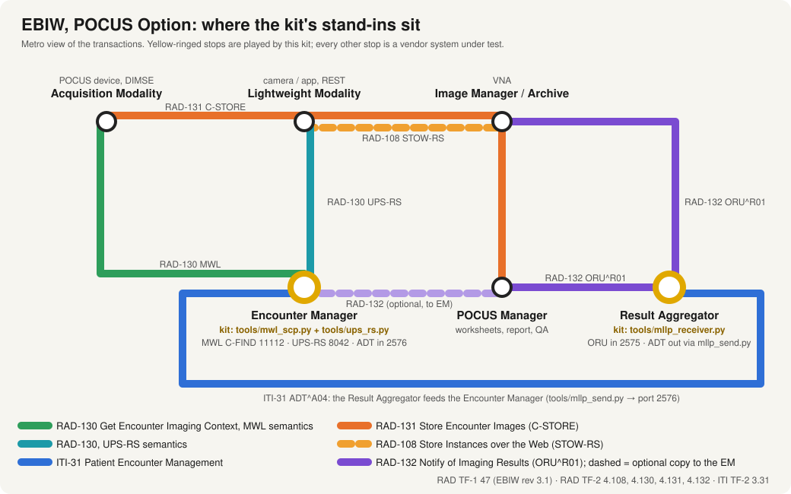
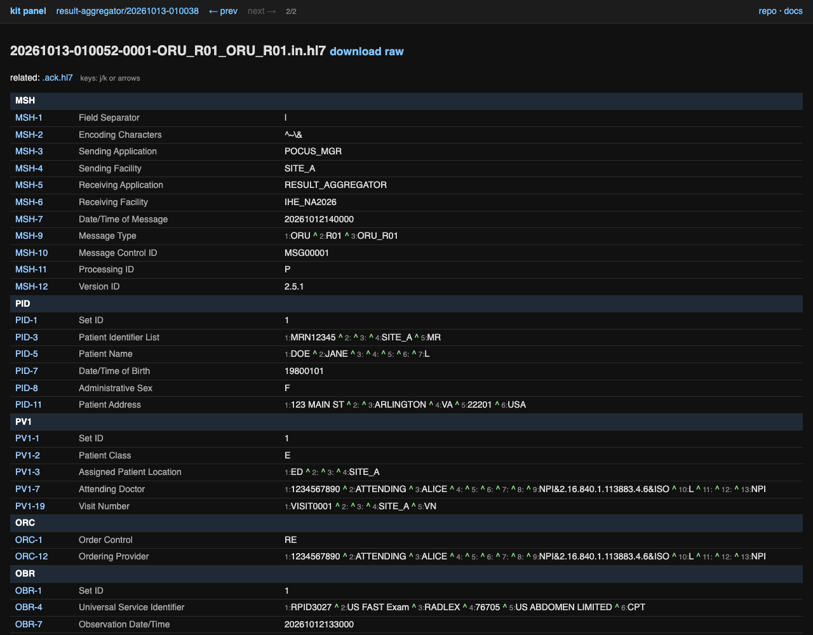
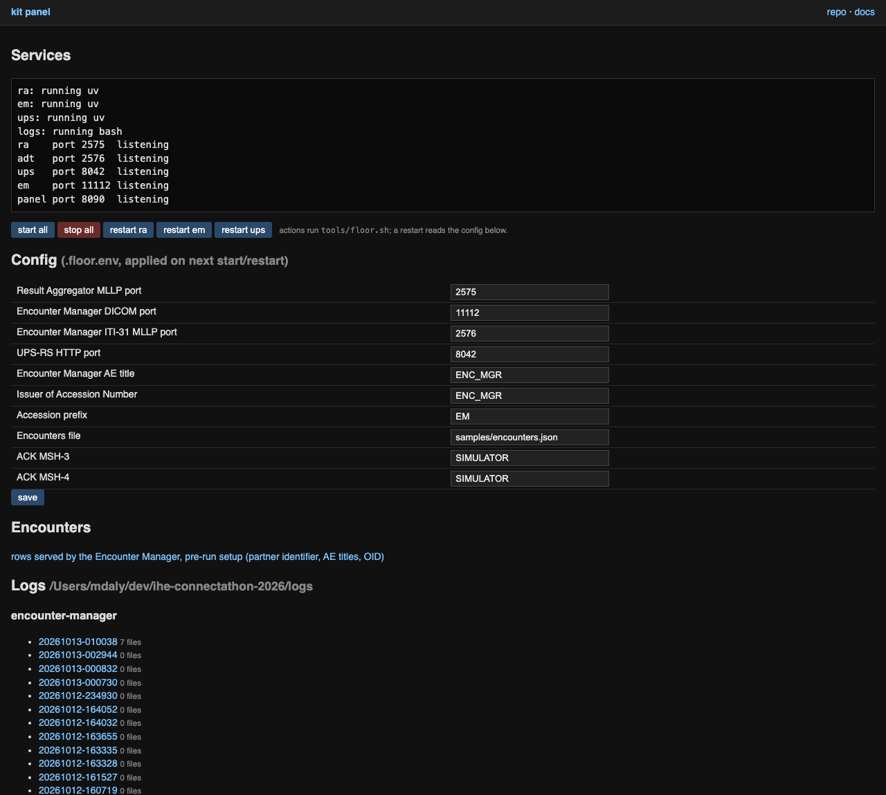
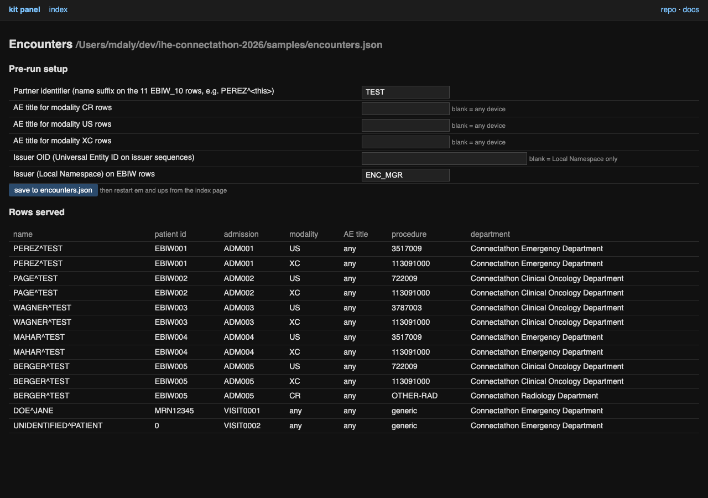

# IHE Connectathon kit

[](https://github.com/markdaly/RAD.EBIW.tooling/actions/workflows/ubuntu-smoke.yml)

Small stand-in IHE actors and monitor notes, written on a Connectathon floor when a vendor's
test partner did not exist. Python, one file per actor, raw logs of every message, config by
environment variables. Built for the Radiology **EBIW** profile (Encounter-Based Imaging
Workflow, POCUS Option) and reusable for any HL7 v2 or DICOM worklist partner you are missing.

| Tool | Actor it stands in for | Transaction | Port (default) |
|---|---|---|---|
| `tools/mllp_receiver.py` | Result Aggregator, or any HL7 v2 sink | RAD-132 ORU in, ACK out (MLLP, optional TLS) | 2575 |
| `tools/mwl_scp.py` | Encounter Manager | RAD-130 Modality Worklist C-FIND (POCUS Option keys); ITI-31 ADT intake | 11112, 2576 |
| `tools/ups_rs.py` | Encounter Manager, REST side | RAD-130 UPS-RS search (`GET /workitems`, `/studies`), dicom+json | 8042 |
| `tools/mllp_send.py` | test sender | send one HL7 file, print the ACK | |
| `tools/mwl_find.py` | test modality | RAD-130 C-FIND with the EBIW required keys | |
| `tools/floor.sh` | | run everything in one tmux session; restart one server; status; ports from `.floor.env` | |
| `tools/panel.py` | | local web panel: service control, port config, log browser with HL7 field view and raw export | 80, 8090 |
| `tools/hl7show.py` | | console HL7 pretty-printer with field names; prev/next through a session folder | |



Quick start (macOS or Linux, needs [uv](https://docs.astral.sh/uv/)):

```bash
git clone <this repo> && cd <this repo>
tools/floor.sh start      # three servers + a log window in tmux session "ihe"
tools/floor.sh status     # four ports listening?
                          # (also starts the panel on :80 and :8090; floor devices read, control is local-only)
tmux attach -t ihe
```

Then read [docs/RUNNING.md](docs/RUNNING.md) for env vars, ports, where logs and state live, and
[docs/TROUBLESHOOTING.md](docs/TROUBLESHOOTING.md) when something does not arrive.

The panel (started by `tools/floor.sh start`, ports 80 and 8090 on all interfaces) shows service status, lets you start,
stop and restart the servers, edit ports and the encounter set, and browse every capture with
HL7 rendered field by field, prev/next, the paired ACK, and a byte-exact raw download for Gazelle:



<details><summary>More screenshots: index and encounter setup</summary>





</details>

## Status and honesty

This is a **rapid-response toolkit, not a product**. It was written during a Connectathon, in
hours, with AI assistance (Claude), to unblock testing when a profile had no partner actor on the
floor. Read any tool top to bottom before trusting it; each is short on purpose. Specifically:

- The tools are **test partners**, not reference implementations of any IHE profile. They accept,
  log, and answer with the minimum the transaction requires. They do not validate, grade, or
  rewrite anything a vendor sends.
- Requirements quoted in the docs and issues cite IHE Technical Framework section and table
  numbers. Where something was written from memory the text says so. Check the TF before
  arguing with a vendor.
- Not endorsed by, affiliated with, or reviewed by IHE International. IHE, Gazelle and DICOM are
  marks of their respective owners. Technical Framework text is quoted briefly under fair use and
  is copyright IHE International; the documents themselves are not redistributed here.
- Never for clinical use. Test-floor traffic only.
- Apache-2.0 licensed, same license as IHE's own `connectathon-artifacts`, no warranty. See [LICENSE](LICENSE) and [NOTICE](NOTICE).

## Specification

- IHE wiki profile page: https://wiki.ihe.net/index.php/Encounter-Based_Imaging_Workflow
- IHE Radiology Technical Framework index: https://profiles.ihe.net/RAD/
- EBIW supplement (Trial Implementation, rev 3.1): https://www.ihe.net/uploadedFiles/Documents/Radiology/IHE_RAD_Suppl_EBIW.pdf
- IHE's own Connectathon artifacts: https://github.com/IHE/connectathon-artifacts

## Layout

| Path | Contents |
|---|---|
| `tools/` | The stand-ins and test scripts. Each tool documents itself at the top of the file. |
| `samples/` | Canned HL7 v2 messages and a sample encounter list, synthetic data only. |
| `docs/INSTALL.md` | Prerequisites and first run. |
| `docs/RUNNING.md` | Every tool, every env var, every port, logs and state. |
| `docs/TROUBLESHOOTING.md` | When nothing arrives, when ACKs say AR, when the worklist is empty. |
| `docs/TOOLS.md` | Existing Gazelle/NIST simulators to use first; stand-in designs, built and unbuilt. |
| `docs/RAD.md`, `docs/ITI.md` | Radiology and IT Infrastructure cheat sheets for monitors. |
| `docs/TLS-CERTS.md` | Cert, CRL and mobile trust triage with the openssl commands. |
| `events/<event>/` | Everything specific to one Connectathon: connection tables, the troubleshooting diary, issues, the floor-support protocol and issue template, artifacts. Each file carries a front-matter header naming the event. Nothing in there outlives the event. |
| `CLAUDE.md` | Brief for AI-assisted sessions: hard rules for stand-in tools, stack, working style. |

Current event: [events/2026-na-connectathon/](events/2026-na-connectathon/README.md).

## Hard rules for stand-in tools

- Stand-ins are partner substitutes approved by the event's Technical Project Manager, never
  judges. Nothing here grades, auto-passes, or rewrites a vendor's messages.
- One file, one actor, one or two transactions, readable top to bottom in about five minutes.
- Log everything raw: every inbound message and every outbound response to a timestamped file.
  Those files are the evidence a vendor attaches in Gazelle.
- Stateless unless the specification forces state (the Encounter Manager must hand out the same
  accession for the same admission and device: that is a dict written to a JSON file, not a database).
- Config by environment variables. Must be re-pointable on a floor network in seconds.
- No vendor or product names in committed files or logs. Roles and Gazelle system keywords only.

## Contributing

Fork, branch, PR. See [CONTRIBUTING.md](CONTRIBUTING.md) for the flow, the rules above in more
detail, and how to loopback-test a change before it meets a vendor.
